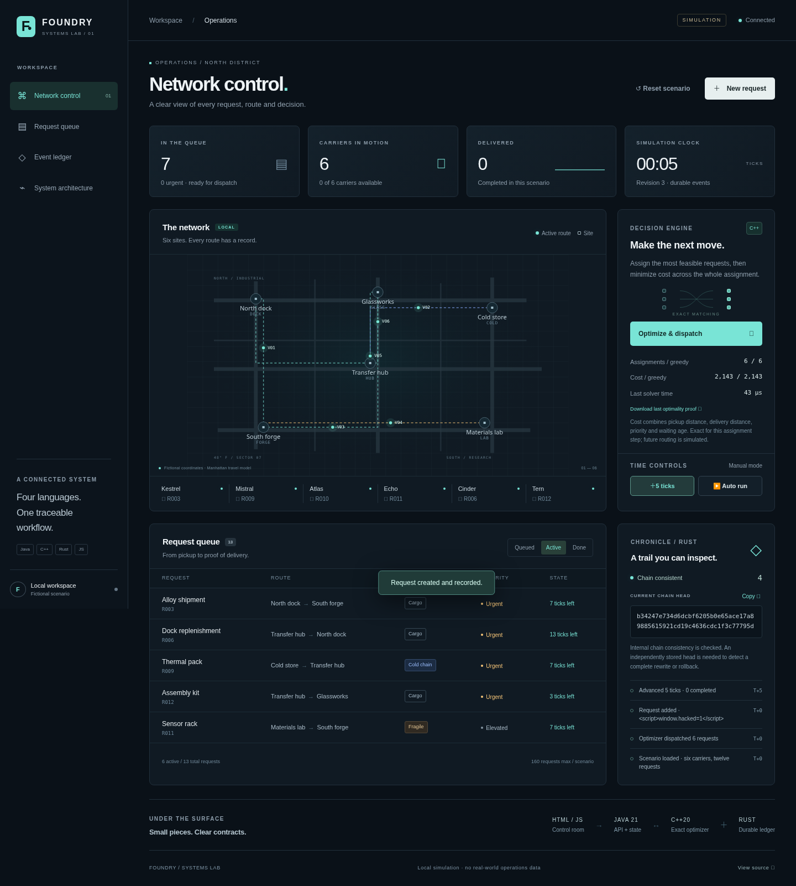

# Systems Foundry

[](https://github.com/Ev3ilMor3ty/systems-foundry/actions/workflows/checks.yml)

**A small operations system with an optimizer you can verify and a ledger you can inspect.**

Java coordinates a fictional logistics district. C++ makes the dispatch decision. Rust commits the event before the browser sees it. A dependency-free HTML/CSS/JavaScript interface puts the whole workflow on one screen.



## Four projects, one working example

| Project | Language | What it does on its own |
| --- | --- | --- |
| [Dispatch](dispatch/) | C++20 | Exact maximum-cardinality, minimum-cost bipartite matching, with primal/dual optimality certificates and a separate Python verifier. |
| [Chronicle](chronicle/) | Rust | Locked, hash-chained JSONL ledger with durable appends, idempotency keys, bounded input and external head verification. |
| [Control API](control-api/) | Java 21 | Local HTTP API, serialized transitions, revision conflicts, subprocess deadlines, durable recovery and bounded live snapshot streams. |
| [Control Room](control-room/) | HTML, CSS, JavaScript | Interactive routes, request creation, carrier status, scenario playback, ledger inspection and downloadable optimizer proofs. |

The separate [WorkPulse repository](https://github.com/Ev3ilMor3ty/kernel-workpulse) contains the Linux kernel C module, Rust telemetry reader and networkless QEMU tests.

## Run it

Requires **JDK 21**, **Rust 1.85+**, **G++ with C++20**, **Maven 3.8.7+** and Make on Linux. Node is needed for frontend checks, not to run the dashboard.

```bash
git clone https://github.com/Ev3ilMor3ty/systems-foundry.git
cd systems-foundry
./scripts/build.sh
./scripts/run.sh
```

Open **http://127.0.0.1:8090**. Click **Optimize & dispatch**, advance the simulation, or create another request. **Auto run** advances only the fictional scenario while the page is open.

Windows users can build with PowerShell or use WSL2. Detailed prerequisites, commands, portable package instructions and troubleshooting are in [the installation guide](docs/INSTALL.md).

## A decision with a proof

The objective is deliberately precise: assign as many eligible carrier/request pairs as possible, then minimize their total integer cost. This is one dispatch step, not a claim to solve general vehicle routing.

The C++ solver returns a feasible matching, a saturated-cut witness for maximum cardinality and node potentials proving that no cost-improving residual cycle exists. Java checks these witnesses before changing the scenario. A separate Python tool can verify an exported dashboard proof without invoking the optimizer:

```bash
python3 dispatch/tools/check_certificate.py foundry-proof-revision-1.json
```

Try a small instance where greedy matching loses an assignment:

```bash
./dispatch/build/foundry-dispatch < dispatch/examples/rematching.json
```

## Commit first, publish second

Every accepted state change is stored in Chronicle before it is published through the API or live stream. Reusing a command ID with the same request replays its result; reusing it for a different request is a conflict. A lost acknowledgement around a crash can therefore be retried without duplicating the transition.

Chronicle verifies the chain on open and owns an exclusive writer lock. A broken tail or uncertain I/O outcome fails closed. Hash chaining is **tamper-evident relative to a trusted head**: it does not prevent someone who controls the whole file from rewriting it and recomputing every hash. Keep head anchors independently if that threat matters.

## Check the claims

```bash
./scripts/check.sh
./scripts/check.sh --integration
make -C dispatch sanitize
```

The integration harness exercises the actual Java/C++/Rust processes, including crashes, restarts, idempotent retries, dependency death and final ledger verification. Browser checks cover the live workflow, proof downloads, plain-text rendering, responsive layouts and automated accessibility checks. These checks are finite evidence, not a guarantee of production reliability.

See [test results and their limits](docs/VALIDATION.md), [architecture and protocol contracts](docs/ARCHITECTURE.md), and [component benchmarks](docs/BENCHMARKS.md).

## Scope

This is a local systems portfolio and a fictional simulation. The server binds to `127.0.0.1`, checks the request host/origin, and has no user accounts or production authentication. The event file is capped at 64 MiB and 100,000 records; individual records are capped at 1 MiB. Archive a finished workspace and choose a new data directory for another long run.

MIT for the project code, with third-party notices preserved. The separate kernel module is GPL-2.0-only. See [LICENSE](LICENSE) and [THIRD_PARTY.md](THIRD_PARTY.md).
