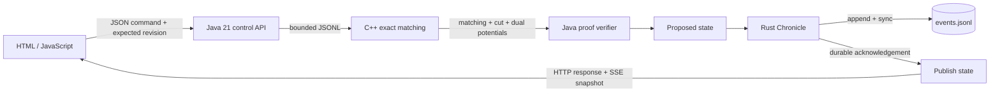

# Architecture and contracts



## A serialized state machine

The Java service holds one reentrant mutation lock. Each command includes a unique `commandId` and the `expectedRevision` visible to the caller. A stale revision produces HTTP 409. Concurrent commands against one revision have exactly one winner.

Before computing a new transition, the service asks Chronicle whether that command ID already exists. The same operation and full request replay the committed revision; a different request with the same ID conflicts. The replay response contains the current snapshot as well as the original committed revision, so a retry does not roll the browser back.

The next state is computed on a copy. A successful ledger acknowledgement happens before replacing the in-memory state or publishing a live event. If an append times out, the outcome may be uncertain: a record could have reached storage while its acknowledgement was lost. The service stops further writes until restart and replay resolves the history. It does not pretend the append was rolled back.

Reset starts a fresh fictional scenario at tick zero but increments the global revision and appends another event. Earlier history remains in the ledger.

## Optimizer boundary

A problem has `workers`, `tasks` and unique `(worker, task, cost)` edges. Dimensions are 0..256 and each integer cost is 0..1,000,000,000. Every vertex has capacity one. The C++ library and JSON CLI implement maximum-cardinality matching followed by minimum total cost.

In the demo, only idle carriers and queued requests enter the problem. Capability compatibility determines edges. Cost is:

```text
10 * Manhattan(carrier, pickup)
+ 3 * Manhattan(pickup, destination)
+ max(0, (3 - priority) * 240 - min(waiting_age, 120) * 2)
```

Costs are fictional units, not measured delivery time or money. Movement duration is a separate deterministic simulation model. This is an exact single-step assignment problem; it does not model future congestion, battery state or a complete vehicle-routing schedule.

The certificate contains:

- The feasible matching and its exact total cost.
- A source-side vertex set with cut capacity equal to the matching cardinality.
- Node potentials making every residual arc's reduced cost nonnegative.

The verifier reconstructs the residual network from the input and claimed matching. A closed cut with equal capacity proves maximum cardinality. Nonnegative residual reduced costs exclude a negative-cost cycle and prove minimum cost for that flow. Neither verifier calls the optimizer. The certificate proves the answer for the supplied model; it does not certify the real-world truth of its inputs.

Vertex numbering is workers first, then tasks, source at `workers + tasks`, sink immediately after source. The Python verifier uses explicit checks, which remain enabled with `python -O`.

## Ledger boundary

Chronicle owns one OS file lock and keeps verified records plus an ID index in memory. Limits are 1 MiB per record, 64 MiB per ledger and 100,000 records. The JSONL stdio interface is also bounded. Validation errors do not append; an append I/O failure poisons that writer instance.

Each record contains sequence number, predecessor hash, command ID, event and SHA-256 hash. The domain-separated hash payload is the JSON array:

```json
["foundry-chronicle-v1", 1, "PREVIOUS_HASH", "COMMAND_ID", {"event":"value"}]
```

Serde JSON's default sorted object maps define this implementation's serialization. This is not a claim of RFC 8785 compatibility or arbitrary-precision decimal canonicalization. Use Chronicle itself to produce and verify the format.

A complete line terminator is required. Missing newline, malformed JSON, duplicate ID, broken sequence, predecessor mismatch or hash mismatch stops replay. The file is never silently repaired or truncated. On Unix, the containing directory is synced on open; each appended record uses `sync_data`. The caller must provision a durable parent directory and storage must honor sync guarantees.

A standalone verify uses a shared nonblocking lock, so it refuses to race the active writer. Stop the service before an independent full-file verification. During service operation, the dashboard reports the chain verified at open plus the process's own subsequent appends. Locks coordinate cooperating processes; they do not prevent an administrator from editing the underlying file.

## HTTP and live events

- `GET /api/state`: full snapshot with revision and current audit head.
- `GET /api/health`: dependency state, request counts and connected live clients.
- `GET /api/events`: server-sent full snapshots with revision IDs and heartbeats.
- `POST /api/plan`: verify and apply one assignment step.
- `POST /api/advance`: advance 1..30 ticks.
- `POST /api/task`: add a validated request, up to 160 per scenario.
- `POST /api/reset`: append a reset event.

POST bodies are UTF-8 JSON objects, capped at 32 KiB. Unknown command fields are rejected. Strict JSON parsing rejects nonstandard syntax. The server binds to IPv4 loopback and checks the Host and optional Origin. It has no public-service authentication layer.

Each live client has a bounded queue of complete snapshots. A slow client may skip intermediate revisions safely because the newest event contains the full state. Clients reconnect with a fresh full snapshot; this is not an exactly-once event-delivery protocol. The browser ignores older revisions, including races around connection setup.

## Native process lifecycle

Java starts explicit argument arrays without a shell. Blocking pipe I/O runs on two dedicated platform threads; reentrant locks avoid pinning Java 21 virtual-thread carriers while requests wait for worker replies. Workers receive bounded lines and have deadlines. A timed-out, malformed or prematurely closed native peer is killed and is never reused. The ledger path and binary paths are local configuration, not user-supplied HTTP command strings.

Linux test harnesses freeze binary copies, use exact child identity checks and pidfds for injected signals, and adopt/reap their own orphaned descendants after intentional crashes. They do not kill arbitrary process names. Kernel tests run separately in QEMU and never load modules into the host.
